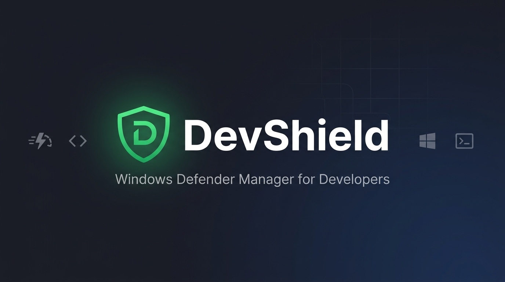
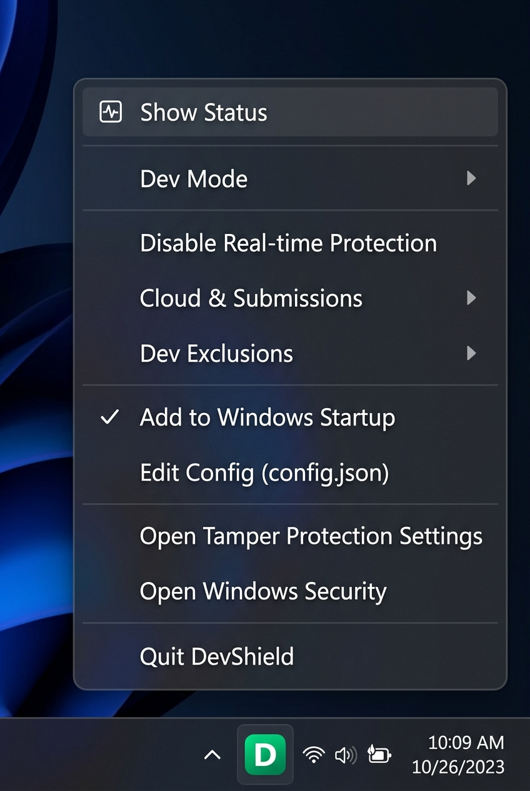
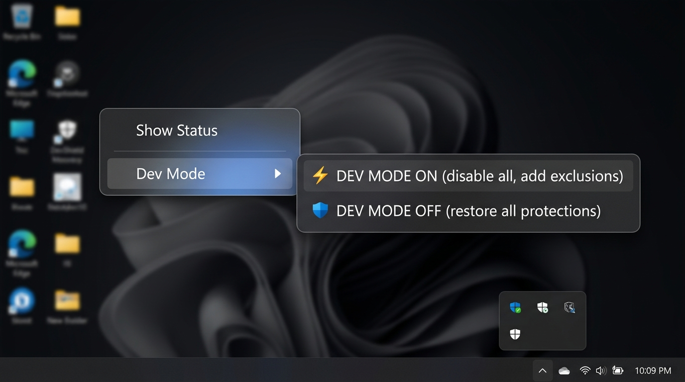
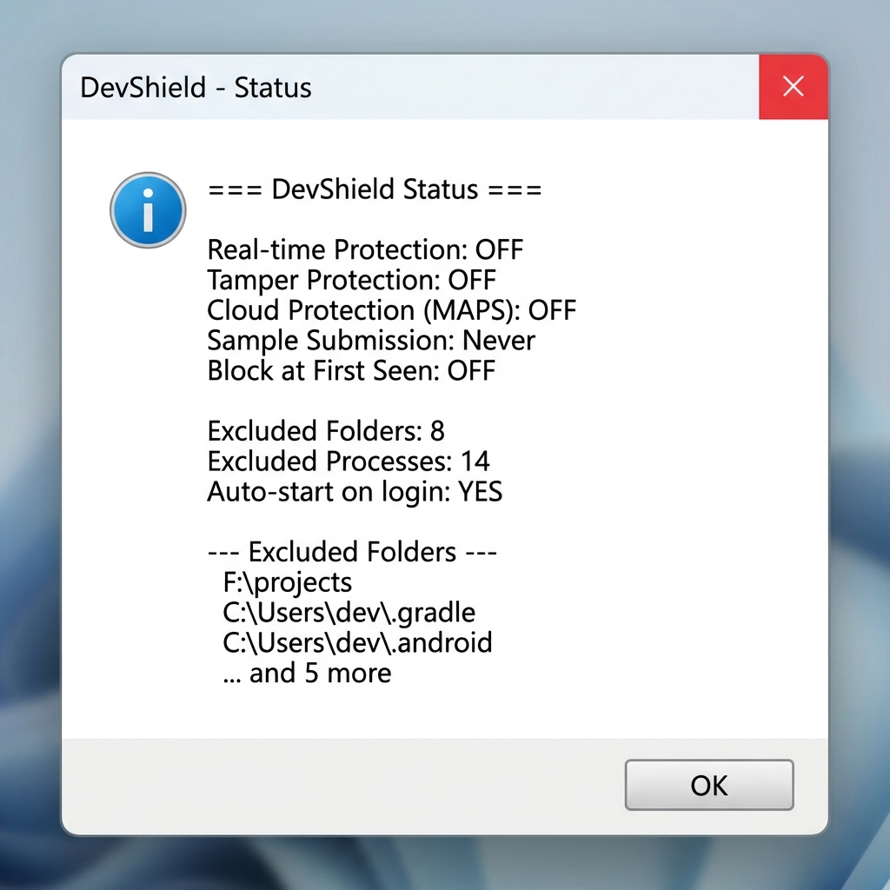

<p align="center">
  
</p>

<h1 align="center">DevShield 🛡️</h1>

<p align="center">
  <strong>A developer-friendly Windows Defender manager that lives in your system tray.</strong>
  <br>
  One-click toggle to speed up builds, Android emulators, and dev workflows.
</p>

<p align="center">
  
  
  
  
</p>

---

## ❓ Why DevShield?

Windows Defender's real-time protection, cloud submissions, and file scanning can significantly slow down:

- 🐢 **Android Studio** builds & Gradle sync
- 🐢 **Android Emulator** startup and performance
- 🐢 **Node.js / npm** installs and builds
- 🐢 **Visual Studio / MSBuild** compilations
- 🐢 **Python** package installs and test runs

DevShield gives you a **system tray icon** to instantly toggle these protections on/off — or better yet, add smart **exclusions** so Defender skips your dev files while still protecting the rest of your system.

---

## 📸 Screenshots

<p align="center">
  
  &nbsp;&nbsp;&nbsp;
  
</p>

<p align="center">
  <em>System tray context menu &nbsp;•&nbsp; One-click Dev Mode</em>
</p>

<p align="center">
  
</p>

<p align="center">
  <em>Full status overview with all protection states</em>
</p>

---

## ⚡ Features

| Feature | Description |
|---------|-------------|
| **🚀 Dev Mode ON/OFF** | One-click to disable ALL protections + add exclusions for max dev speed |
| **🔴🟢 Real-time Protection** | Toggle Defender real-time scanning from the tray |
| **☁️ Cloud & Submissions** | Disable cloud-delivered protection, sample submission, Block at First Seen, IOAV |
| **📁 Dev Exclusions** | Add/remove folder & process exclusions — the Microsoft-recommended way |
| **🔄 Auto-start** | Option to run on Windows startup (via tray menu) |
| **📊 Status Dashboard** | See all protection states, exclusion counts, and cloud settings at a glance |
| **🎨 Color-coded Icon** | 🟢 Protected &nbsp;•&nbsp; 🟠 Exclusions active &nbsp;•&nbsp; 🔴 RT off &nbsp;•&nbsp; ⚪ Unknown |
| **🪟 No Console Window** | Runs silently — only the tray icon, no CMD/terminal window |

---

## 🚀 Quick Start

### 1. Clone the repository

```bash
git clone https://github.com/vishalhoc/DevShield.git
cd DevShield
```

### 2. Install dependencies

```bash
pip install -r requirements.txt
```

### 3. Run DevShield

```bash
python devshield.py
```

Or double-click `run_devshield.bat`.

> **Note:** DevShield automatically requests Administrator privileges on launch — these are required to manage Windows Defender settings.

---

## 🎯 Usage

### Right-click the tray icon to access:

```
Show Status                    ← Double-click for full report
───────────────────────────
Dev Mode ►
  ├─ DEV MODE ON               ← Disable all + add exclusions
  └─ DEV MODE OFF              ← Restore all protections
───────────────────────────
Disable/Enable Real-time Protection
Cloud & Submissions ►
  ├─ Disable Cloud + Submissions
  └─ Enable Cloud + Submissions
Dev Exclusions ►
  ├─ Add Dev Exclusions
  └─ Remove Dev Exclusions
───────────────────────────
✓ Add to / Remove from Windows Startup
Edit Config (config.json)
───────────────────────────
Open Tamper Protection Settings
Open Windows Security
───────────────────────────
Quit DevShield
```

### Recommended workflow:

1. **First time:** Right-click → **"Open Tamper Protection Settings"** → Turn OFF Tamper Protection
2. **Before coding:** Right-click → **Dev Mode** → **"DEV MODE ON"**
3. **Done for the day:** Right-click → **Dev Mode** → **"DEV MODE OFF"**

---

## ⚙️ Configuration

Edit `config.json` to customize which folders and processes are excluded from Defender scanning:

The default `config.json` includes **200+ entries** covering virtually every developer tool:

| Category | Folders | Processes |
|----------|---------|-----------|
| **Android Studio / Emulator** | SDK, AVD, Gradle, project dirs | `studio64.exe`, `adb.exe`, `emulator.exe`, `qemu-system-*` |
| **Java / Kotlin / JVM** | `.gradle`, `.m2`, `.jdks`, JDK installs | `java.exe`, `javac.exe`, `gradle.exe`, `mvn.cmd`, `kotlin.bat` |
| **Node.js / JavaScript** | npm-cache, Yarn, pnpm, Deno, Bun | `node.exe`, `npm.cmd`, `yarn.exe`, `pnpm.exe`, `esbuild.exe`, `tsc.cmd` |
| **Python** | virtualenvs, pip, conda, Poetry, pyenv | `python.exe`, `pip.exe`, `conda.exe`, `pytest.exe`, `jupyter.exe` |
| **.NET / C#** | NuGet, .dotnet | `dotnet.exe`, `MSBuild.exe`, `csc.exe`, `nuget.exe` |
| **Visual Studio** | VS install dirs, local data | `devenv.exe`, `cl.exe`, `link.exe`, `ServiceHub.*.exe` |
| **VS Code** | Extensions, settings | `Code.exe`, `Code - Insiders.exe` |
| **JetBrains IDEs** | IntelliJ, PyCharm, WebStorm, etc. | `idea64.exe`, `pycharm64.exe`, `webstorm64.exe`, all IDEs |
| **Rust** | `.cargo`, `.rustup` | `rustc.exe`, `cargo.exe`, `rust-analyzer.exe` |
| **Go** | GOPATH, go modules | `go.exe`, `gopls.exe`, `dlv.exe` |
| **Flutter / Dart** | Flutter SDK, pub cache | `flutter.bat`, `dart.exe` |
| **C / C++** | MinGW, MSYS2, Conan, vcpkg | `cmake.exe`, `gcc.exe`, `clang.exe`, `ninja.exe`, `make.exe` |
| **Docker** | Docker Desktop, images | `docker.exe`, `dockerd.exe`, `kubectl.exe`, `helm.exe` |
| **Ruby / PHP** | Gems, Composer, XAMPP, Laragon | `ruby.exe`, `php.exe`, `composer.bat` |
| **Game Engines** | Unity, Unreal, Godot | `Unity.exe`, `UnrealEditor.exe`, `ShaderCompileWorker.exe` |
| **Databases** | MongoDB, PostgreSQL, MySQL, Redis | `mongod.exe`, `postgres.exe`, `redis-server.exe` |
| **Cloud CLIs** | AWS, Azure, GCP, Terraform, K8s | `gcloud.cmd`, `aws.exe`, `az.cmd`, `terraform.exe` |
| **Misc Tools** | Git, terminals, WSL, editors | `git.exe`, `wsl.exe`, `curl.exe`, `postman.exe` |

<details>
<summary>📋 Example config.json (click to expand)</summary>

```json
{
    "exclusion_folders": [
        "F:\\projects",
        "%USERPROFILE%\\.gradle",
        "%USERPROFILE%\\.android",
        "%LOCALAPPDATA%\\Android\\Sdk",
        "%USERPROFILE%\\AndroidStudioProjects",
        "%USERPROFILE%\\.m2",
        "%LOCALAPPDATA%\\npm-cache",
        "%USERPROFILE%\\.cargo",
        "%USERPROFILE%\\.nuget",
        "%LOCALAPPDATA%\\Docker",
        "%LOCALAPPDATA%\\JetBrains",
        "%TEMP%"
    ],
    "exclusion_processes": [
        "studio64.exe",
        "java.exe", "gradle.exe",
        "adb.exe", "emulator.exe", "qemu-system-x86_64.exe",
        "node.exe", "python.exe",
        "devenv.exe", "MSBuild.exe", "Code.exe",
        "docker.exe", "git.exe",
        "rustc.exe", "cargo.exe",
        "go.exe", "dotnet.exe"
    ]
}
```

</details>

> **Tip:** The full default config covers 200+ entries across all categories. Edit `config.json` to add/remove as needed. Environment variables like `%USERPROFILE%` are expanded automatically. Lines starting with `__COMMENT` are used for organization and are ignored.

---

## 🔒 Tamper Protection

Windows **Tamper Protection** prevents any program from modifying Defender settings. If DevShield shows a warning about Tamper Protection:

1. Open **Windows Security** → **Virus & threat protection**
2. Click **Manage settings**
3. Scroll to **Tamper Protection** → Turn **OFF**
4. Now DevShield can manage all settings

> This is a one-time manual step. Microsoft requires this to be done by the user — no software can bypass it (by design).

---

## 🧱 How It Works

DevShield uses standard Windows PowerShell cmdlets — no registry hacks, no group policy manipulation:

| Action | PowerShell Command |
|--------|-------------------|
| Disable Real-time | `Set-MpPreference -DisableRealtimeMonitoring $true` |
| Disable Cloud (MAPS) | `Set-MpPreference -MAPSReporting Disabled` |
| Stop Sample Submission | `Set-MpPreference -SubmitSamplesConsent 2` |
| Disable Block at First Seen | `Set-MpPreference -DisableBlockAtFirstSeen $true` |
| Add Folder Exclusion | `Add-MpPreference -ExclusionPath "path"` |
| Add Process Exclusion | `Add-MpPreference -ExclusionProcess "name.exe"` |

All commands are written to a `.ps1` script file before execution to avoid shell escaping issues.

---

## 📋 Requirements

- **OS:** Windows 10 / 11
- **Python:** 3.8 or later
- **Privileges:** Administrator (auto-requested)
- **Dependencies:** `pystray`, `Pillow` (auto-installed)

---

## 📁 Project Structure

```
DevShield/
├── devshield.py          # Main application
├── config.json           # Exclusion configuration
├── run_devshield.bat     # Quick launcher (no console)
├── requirements.txt      # Python dependencies
├── LICENSE               # MIT License
├── README.md             # This file
└── screenshots/          # Repository screenshots
    ├── banner.png
    ├── tray-menu.png
    ├── dev-mode.png
    └── status-dialog.png
```

---

## 🤝 Contributing

Contributions are welcome! Feel free to:

1. Fork the repository
2. Create a feature branch (`git checkout -b feature/amazing-feature`)
3. Commit your changes (`git commit -m 'Add amazing feature'`)
4. Push to the branch (`git push origin feature/amazing-feature`)
5. Open a Pull Request

---

## 📄 License

This project is licensed under the MIT License — see the [LICENSE](LICENSE) file for details.

---

<p align="center">
  Made with ❤️ for developers who just want their builds to be fast.
</p>
